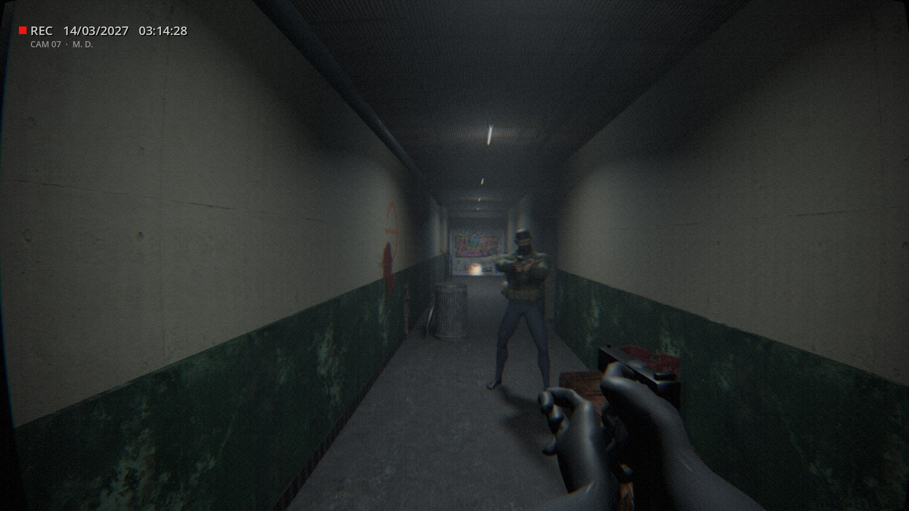
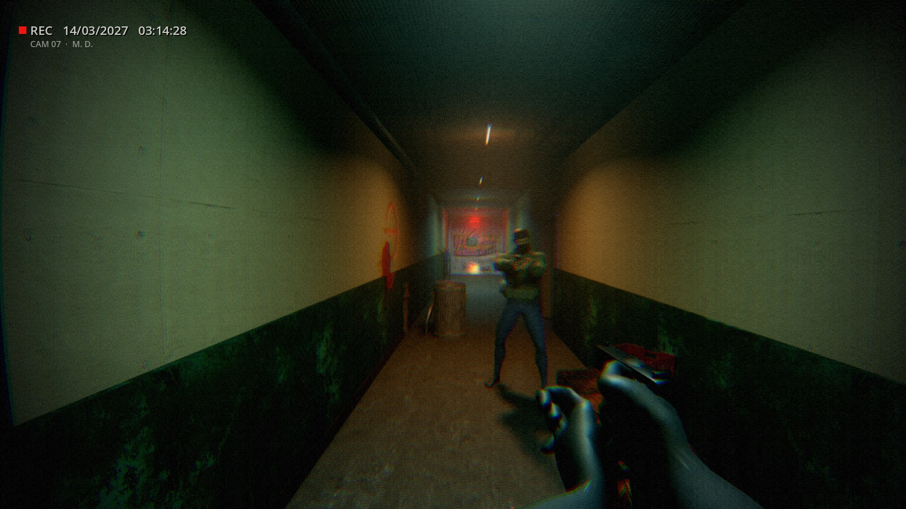

# Dernière mission

> ⚠️ **Contenu très violent, réservé aux adultes (18+).** Sang, démembrement, violence armée réaliste. Tout est fictif.

FPS solo en vue **caméra-piéton** (bodycam) : réalisme, tension, combats courts et mortels, niveaux en couloirs, et une histoire racontée entre et pendant les niveaux. Fait avec [Godot 4.7](https://godotengine.org) et [Blender](https://www.blender.org).

## L'histoire
Marc, 48 ans, ancien commando retiré depuis dix ans, débarque clandestinement à Puerto Ceniza, grande ville portuaire d'un pays fictif d'Amérique latine. Sa fille Léa, 22 ans, y a été enlevée par le cartel du Cercle de cuivre parce qu'elle a vu ce qu'elle n'aurait pas dû voir. Marc porte une caméra pour que son vieil ami de l'armée, Vincent, le guide à distance par radio. Huit niveaux, trois fins selon ta façon de jouer.

## État
Phase 0 (recherche et direction artistique). Pas encore jouable.

## Commandes (prévues)
Clavier et souris uniquement. ZQSD / WASD se déplacer · Maj courir · Ctrl s'accroupir · A / E se pencher · Espace petit saut · clic gauche tirer · clic droit viser · R recharger · F interagir. Touches réassignables dans les options.

## Lancer
- **Windows** : décompresser le `.zip` de la [dernière Release](../../releases) et lancer `derniere_mission.exe`.
- **Linux (x86_64)** : décompresser le `.tar.gz`, puis `./derniere_mission.x86_64`.
- **Depuis les sources** : ouvrir le dossier avec Godot 4.7.

## Exporter
Avec Godot 4.7 et ses modèles d'export : `godot --headless --export-release "Windows Desktop"` et `godot --headless --export-release "Linux"` (préréglages fournis à partir de la phase 1). Les exports sont aussi fabriqués automatiquement par GitHub Actions à chaque version.

## Crédits et licence
- Ressources externes et leurs licences : [CREDITS.md](CREDITS.md)
- Licence : [LICENSE](LICENSE) — code sous licence MIT ; histoire, textes et contenus créés pour le jeu tous droits réservés ; ressources externes sous leur propre licence (voir CREDITS.md)
